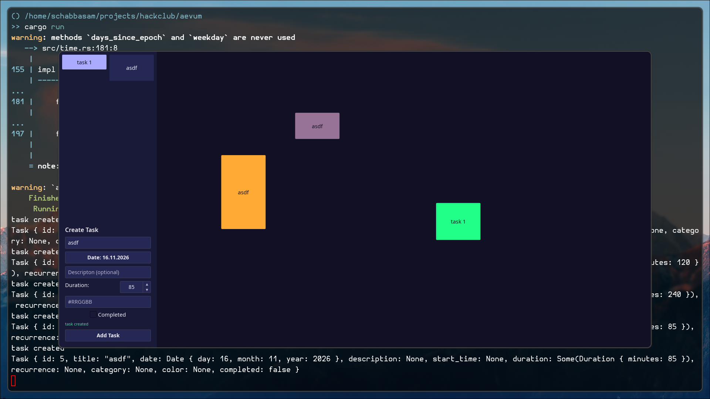

# Schraubim
*Work in progress*

A simple weekly planner with time boxing, written in Rust and Slint.


## About

Schraubim (formerly called Aevum) is a weekly planner designed to help organize tasks and manage time more efficiently.

The project is still in development, and the user interface is not finished yet.

'Schraubim' is the name I chose because it is very unique and sounds cool. The old name 'Aevum' already had over 20 repositories.

## Rust backend

The main Rust backend is basically finished and can already be used as a standalone API, independently of the user interface.
It lives in `src/core/` and has the main fuctionality of saving, validating and managing the data structures.

The Rust backend specifically for the Slint application is in `src/app`. It is devided into many files to make it much easier to expand and use.

The entry point is `src/lib.rs` that basically just imports the other files and executes the main stuff. It is supposed to be as minimal as possible. `src/main.rs` just points at `lib.rs`.

To demonstrate how it works and test its functionality, I wrote several unit tests. They can be found at the end of three main files in `src/core/`. They are not 100% up to date with the little changes, but they act as a good manual to showcase how it works.

You can run them by executing:

```bash
cargo test
```

## Slint user interface

I chose Slint because I wanted a lightweight, cross-platform framework that allows the application to run on desktop systems and Android devices, and I'm quite happy with the framework after weeks of work with it.

Although a lot of the rough layout is done, it still isn't finished and as polished as the finished product is supposed to be.

Currently, it is built for desktop in landscape mode only. Since I plan to make an android app as well, I'll probably have to make an own layout for it.

Some notes on the current state of the UI (as of 23. Nov.):
- I tried to make the window resizable, but there are problems and I can't get the width to sync with the task-block-width. I will adress this problem as soon as possible.
- there was something else but i cant remember right now

## Planned features

These are the features I plan to implement in the finished application:

- **Drag & Drop:** Task blocks will appear in a panel on the left and can simply be dragged onto the weekly grid.
- **Custom categories and colors:** Organize tasks into custom categories and assign individual colors to them.
- **Recurring tasks:** Set tasks to repeat daily, weekly or on specific weekdays, optionally at the same time.
- **Task details:** Add optional descriptions and specify only a day if you are not sure when exactly to schedule a task.
- **Data management:** Use a proper database, such as SQLite, to store all data in a single file.
- **Synchronization:** Keep the data file easy to synchronize between devices.
- **Mobile app:** I definitely want to create a well-optimized Android version for both phones and tablets. iOS support is still undecided.
- **Settings:** Provide extensive customization options, including UI colors, sizes and spacing.
- **Feature tour:** Add an optional guide to help users discover the application's features and understand where to find them.

Drag & drop works pretty reliably now. The other features still need to be honed and some of them are of lower priority.
The things I will most likely add the soonest are Recurrence and Category implementations.

## Installation

Download the latest version for your platform from the [Releases](../../releases) page.

Note: the builds don't work right now, but it doesn't matter because it was just the UI anyway (as of now).
I will fix that later when it is important. 

You can just look at the web preview. It is pretty much the exact same thing right now, it's just that the performance might not be as smooth.

## Building from Source

### Requirements

- Rust and Cargo
- A compatible operating system and the required Slint dependencies

### Build and run

To run the application from source, clone the repository and execute:

```bash
git clone https://github.com/schabbasam/schraubim.git
cd schraubim
cargo run --release
```

## Web preview

A web preview is also available: https://schabbasam.github.io/schraubim/

Note: I disabled the website temporarily because I kept pushing commits for everything and the poor github workflow ran every time. But it should be up and running now.

## Other stuff

The official [Slint docs](https://docs.slint.dev/latest/docs/slint/) helped a lot! Almost everything is explained here, and the things that aren't can be looked up in the compiler's source code on github.

## License

Feel free to use, modify and distribute this software under the terms of its license, provided that you give appropriate credit to the original authors. Actually just do what you want. More details are in the `LICENSE` file.

Please refer to the [Slint licensing information](https://slint.dev/pricing) regarding Slint's license terms.
